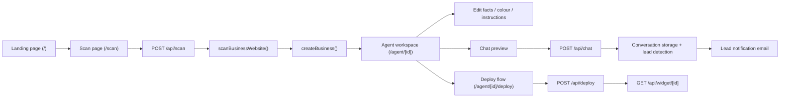

# AgentDrop Codebase and Build Status

Last updated: 2026-04-05
Workspace: `/Users/caeseyfraser/Desktop/URL TO AGENT AI APP`

## Purpose

This is a living snapshot of the current AgentDrop codebase, what is already working, what is intentionally parked, and what still needs to be wired up before this becomes a full production platform.

## Executive Summary

- AgentDrop is a Next.js 14 + TypeScript MVP that turns a business website into a grounded AI chat agent.
- The app currently defaults to `studio` mode via `lib/app-mode.ts`, so the active build focus is:
  - scan a real website
  - review and edit extracted business facts
  - test grounded chat locally
- Platform-mode flows still exist in the codebase, including login, dashboard, pricing, checkout, deploy, Supabase, Stripe, and widget install flows, but they are intentionally hidden or parked when studio mode is active.
- There is also a second-generation ingestion pipeline under `apps/` and `packages/`. It compiles and exposes `/api/v1/ingestions`, but it is not yet wired into the main landing page or scan UI.

## Verified Build Snapshot

Checks run on 2026-04-05:

- `npm run typecheck`: passed
- `npm run build`: passed
- `npm run ops:preflight`: failed in this workspace because production env vars are not configured
- `git status`: not available because this folder is not currently a Git repository

Current local workspace snapshot:

- Source footprint: 85 files across `app`, `apps`, `components`, `lib`, `packages`, `scripts`, `supabase`, `docs`, `data`, and `public`
- Local fallback database `.data/agentdrop.json`:
  - 39 businesses
  - 24 conversations
  - 5 lead notifications
- Ingestion engine database `.data/ingestion-engine.json`:
  - 3 ingestion jobs
  - 45 crawled pages
  - 3 business profiles

## Where We Are Right Now

### Active build focus

The current build is strongest as a local studio workflow:

1. Paste a website URL on `/`
2. Run a real crawl via `/api/scan`
3. Create a business record from the extracted site data
4. Open `/agent/[id]` to review facts, warnings, and sources
5. Adjust accent color and assistant instructions
6. Test the grounded chat preview

### What is working now

- Website scan flow is implemented end-to-end.
  - `lib/site-scan.ts` attempts a browser-rendered crawl first, then falls back to an HTML crawl if needed.
  - `lib/business.ts` normalizes extracted business data and optionally refines it with Anthropic when `ANTHROPIC_API_KEY` is present.
- Business persistence is implemented.
  - `lib/repository.ts` writes to Supabase when configured.
  - In studio mode or without providers, it falls back to `.data/agentdrop.json`.
- Agent editing is implemented.
  - `/api/business/[id]` updates the editable business fields and regenerates the system prompt.
  - `components/AgentResultsClient.tsx` exposes edit, brand color, source review, and instruction editing.
- Grounded chat preview is implemented.
  - `components/ChatWidget.tsx` drives the chat UI.
  - `/api/chat` stores conversation history, detects leads, and sends notifications.
  - `lib/business.ts` uses either:
    - Anthropic with grounded context, or
    - deterministic fallback logic built from scanned facts and excerpts
- Lead capture is implemented.
  - Lead details are extracted from messages using `lib/lead-detection.ts`.
  - Notifications are sent through `lib/lead-notifications.ts` and `lib/email.ts`.
- Widget generation is implemented.
  - `/api/widget/[id]` returns embeddable JavaScript.
  - `lib/widget.ts` renders a Shadow DOM chat bubble that posts back to `/api/chat`.
- Platform plumbing is present in code.
  - Magic-link auth, owner dashboard, Stripe checkout, webhook handling, deploy gating, and widget install instructions all exist.
- Ops scripts exist.
  - `scripts/preflight.mjs`
  - `scripts/create-stripe-catalog.mjs`
  - `scripts/smoke.mjs`

### What is present but intentionally parked

Because the default app mode is `studio`, these user-facing areas are deliberately parked in the UI right now:

- `/dashboard`
- `/login`
- `/pricing`
- `/agent/[id]/deploy`
- `/api/auth/magic-link`
- `/api/checkout`
- `/api/deploy`

The code is there, but the current build is not presenting those flows as the main experience.

### What is partial or not yet fully wired

- The new ingestion engine under `apps/api` and `apps/worker` is live as an API surface, but the main landing page and scan flow still use the older `lib/site-scan.ts` and `lib/business.ts` path.
- Production services are not configured in this workspace.
  - Supabase
  - Anthropic
  - Resend
  - Stripe
- The pricing catalog promises features that do not appear to be implemented yet in the current source:
  - analytics dashboard
  - conversation inbox/history UI
  - CRM integration
  - booking system connection
  - white-glove onboarding/account management
- There is no formal unit or integration test suite in the repo. Verification today is mostly:
  - `npm run typecheck`
  - `npm run build`
  - `npm run ops:preflight`
  - `npm run ops:smoke`
- There is no git history available in this folder, so progress has to be inferred from the code itself instead of commit history.

## Product Flow



## UI Surface Status

| Route | Status | Notes |
| --- | --- | --- |
| `/` | Active | Landing page for scan-driven studio flow |
| `/scan` | Active | Runs the scan and redirects into the workspace |
| `/agent/[id]` | Active | Main business/agent review workspace |
| `/agent/[id]/chat` | Active | Standalone grounded chat view |
| `/agent/[id]/deploy` | Parked in studio mode | Real deploy flow exists for platform mode |
| `/dashboard` | Parked in studio mode | Owner dashboard exists for platform mode |
| `/pricing` | Parked in studio mode | Checkout entry point exists for platform mode |
| `/login` | Parked in studio mode | Magic-link auth exists for platform mode |
| `/api/v1/ingestions*` | Active API only | New ingestion engine, not yet used by main UI |

## Architecture Overview

### 1. `app/`

The main Next.js App Router application.

- UI pages for landing, scan, dashboard, login, pricing, and agent workspace
- Route handlers for scan, chat, deploy, checkout, auth, widget delivery, and ingestion APIs

### 2. `components/`

The interactive UI layer.

Key files:

- `components/ScanRunner.tsx`
  - Handles the scan loading state and redirect into the workspace
- `components/AgentResultsClient.tsx`
  - Main studio workspace with facts, warnings, sources, color, and chat preview
- `components/ChatWidget.tsx`
  - In-app chat experience
- `components/DeployExperience.tsx`
  - Platform deploy flow and install instructions
- `components/PricingPageClient.tsx`
  - Checkout plan selection

### 3. `lib/`

The core business logic layer.

Most important files:

- `lib/business.ts`
  - scan normalization
  - system prompt generation
  - grounded reply generation
  - lead summarization
- `lib/site-scan.ts`
  - website crawl, extraction, prioritization, and fallback scanning logic
- `lib/repository.ts`
  - business, conversation, and notification persistence
- `lib/auth.ts`
  - local auth fallback, draft access tokens, login redirects
- `lib/business-access.ts`
  - owner/draft access rules and deploy gating
- `lib/stripe.ts`
  - Stripe checkout session + webhook verification helpers
- `lib/widget.ts`
  - embeddable widget JS source
- `lib/email.ts`
  - lead notification email HTML + Resend delivery

### 4. `apps/` and `packages/`

The newer ingestion-engine direction.

- `apps/api`
  - route logic and services for queued ingestion jobs
- `apps/worker`
  - background ingestion execution
- `packages/shared`
  - shared types for business context, recommendations, and deployment packages
- `packages/db`
  - ingestion-specific DB migration

This looks like a more structured v2 architecture that sits alongside the current MVP app.

### 5. `scripts/`, `docs/`, `supabase/`, `data/`, and `.data/`

- `scripts/`
  - operational tooling for preflight, Stripe catalog sync, and smoke testing
- `docs/`
  - go-live and operator docs
- `supabase/`
  - platform schema for businesses and conversations
- `data/`
  - pricing catalog
- `.data/`
  - local runtime persistence when cloud providers are absent or studio mode is active

## Data and Provider Strategy

### Local-first fallback behavior

The app is intentionally resilient when provider keys are missing:

- scanning still works
- grounded chat still works
- business and conversation data still persist
- draft access still works in local mode

This is done through:

- `.data/agentdrop.json` for businesses/conversations/notifications
- local auth cookies when Supabase browser config is not present
- deterministic fallback replies when Anthropic is not configured
- preview-only email behavior when Resend is not configured
- fake local subscription activation when Stripe is not configured

### Production provider dependencies

To fully activate platform mode, the project expects:

- Anthropic
- Supabase
- Resend
- Stripe

The required env keys are documented in `.env.example` and checked by `scripts/preflight.mjs`.

## End-to-End Capability Breakdown

### Scan and business creation

Primary files:

- `app/api/scan/route.ts`
- `lib/business.ts`
- `lib/site-scan.ts`
- `lib/repository.ts`

Current state:

- implemented
- works in studio mode
- can create businesses without external providers

### Business editing and prompt shaping

Primary files:

- `app/api/business/[id]/route.ts`
- `components/AgentResultsClient.tsx`
- `components/EditBusinessModal.tsx`
- `components/ColourPicker.tsx`

Current state:

- implemented
- persists updates
- regenerates prompt and agent type

### Grounded chat and lead capture

Primary files:

- `components/ChatWidget.tsx`
- `app/api/chat/route.ts`
- `lib/business.ts`
- `lib/lead-detection.ts`
- `lib/lead-notifications.ts`
- `lib/email.ts`

Current state:

- implemented
- grounded fallback logic exists even without Anthropic
- lead notification flow exists
- idempotent notification behavior is covered by the smoke script

### Auth and draft claiming

Primary files:

- `app/login/page.tsx`
- `app/api/auth/magic-link/route.ts`
- `app/auth/callback/route.ts`
- `lib/auth.ts`
- `lib/business-access.ts`

Current state:

- platform-mode implementation exists
- parked in studio mode
- has local auth fallback when Supabase browser config is absent

### Pricing, checkout, and billing

Primary files:

- `app/pricing/page.tsx`
- `components/PricingPageClient.tsx`
- `app/api/checkout/route.ts`
- `app/api/webhook/stripe/route.ts`
- `lib/stripe.ts`
- `data/pricing-catalog.json`

Current state:

- coded
- parked in studio mode
- falls back to local fake activation if Stripe is missing
- production envs are not configured in this workspace

### Deploy and widget install

Primary files:

- `app/agent/[id]/deploy/page.tsx`
- `components/DeployExperience.tsx`
- `app/api/deploy/route.ts`
- `app/api/widget/[id]/route.ts`
- `lib/widget.ts`

Current state:

- coded
- deploy UI is parked in studio mode
- widget delivery endpoint is implemented

### Structured ingestion engine

Primary files:

- `app/api/v1/ingestions/route.ts`
- `app/api/v1/ingestions/[id]/route.ts`
- `app/api/v1/ingestions/[id]/result/route.ts`
- `apps/api/src/routes/ingestions.ts`
- `apps/api/src/services/*`
- `apps/worker/src/jobs/runIngestion.ts`

Current state:

- compiled and callable
- stores jobs/pages/profiles in `.data/ingestion-engine.json`
- not yet connected to the main UI

## Risks, Gaps, and Watchouts

### 1. Two parallel architectures exist

There is a clear split between:

- the current MVP app flow in `app/` + `lib/`
- the newer ingestion-engine stack in `apps/` + `packages/`

That is not a problem by itself, but it means the team should decide whether the next phase is:

- improving the existing studio flow, or
- migrating the UI toward the ingestion engine

### 2. The product story and the shipped code are not fully aligned yet

The pricing catalog markets more than the current UI appears to deliver. That mismatch will matter once platform mode is the default experience again.

### 3. Production readiness depends on env wiring

The build itself is healthy, but production setup is not complete in this workspace. `npm run ops:preflight` currently fails because the required env keys are missing.

### 4. No git history in this folder

The lack of a `.git` directory means there is no branch, commit, or PR context available from inside this workspace.

## Recommended Next Steps

### If the goal is to keep pushing the studio MVP

1. Keep `studio` mode as the default.
2. Tighten scan quality and source visibility.
3. Improve the edit-and-test loop inside `/agent/[id]`.
4. Decide whether the v2 ingestion engine should replace the old scan path or stay experimental.

### If the goal is to return to the full customer platform

1. Switch `AGENTDROP_APP_MODE` / `NEXT_PUBLIC_AGENTDROP_APP_MODE` to `platform`.
2. Configure all required env vars from `.env.example`.
3. Apply `supabase/schema.sql`.
4. Run:
   - `npm run ops:preflight -- --production --check-db`
   - `npm run ops:smoke -- --mode public --base-url <url>`
5. Reconcile the pricing promises with the actual implemented feature set.

### If the goal is to consolidate the architecture

1. Choose one ingestion path as the long-term source of truth.
2. Either wire the UI into `/api/v1/ingestions` or remove the duplication.
3. Add automated test coverage around scan, chat, billing, and widget delivery.

## Full Source Inventory

This is the current source and docs tree excluding `node_modules`, `.next`, and other build caches.

```text
app/agent/[id]/chat/page.tsx
app/agent/[id]/deploy/page.tsx
app/agent/[id]/edit/page.tsx
app/agent/[id]/page.tsx
app/api/auth/magic-link/route.ts
app/api/business/[id]/route.ts
app/api/chat/route.ts
app/api/checkout/route.ts
app/api/deploy/route.ts
app/api/lead-notify/route.ts
app/api/scan/route.ts
app/api/v1/ingestions/[id]/result/route.ts
app/api/v1/ingestions/[id]/route.ts
app/api/v1/ingestions/route.ts
app/api/webhook/stripe/route.ts
app/api/widget/[id]/route.ts
app/auth/callback/route.ts
app/dashboard/page.tsx
app/globals.css
app/layout.tsx
app/login/page.tsx
app/not-found.tsx
app/page.tsx
app/pricing/page.tsx
app/scan/page.tsx
apps/api/src/routes/ingestions.ts
apps/api/src/services/buildBusinessContext.ts
apps/api/src/services/discoverPages.ts
apps/api/src/services/extractors/brand.ts
apps/api/src/services/extractors/contact.ts
apps/api/src/services/extractors/metadata.ts
apps/api/src/services/extractors/offerings.ts
apps/api/src/services/extractors/utils.ts
apps/api/src/services/fetchPage.ts
apps/api/src/services/generateDeploymentPackage.ts
apps/api/src/services/ingestionTypes.ts
apps/api/src/services/queue.ts
apps/api/src/services/recommendAgentType.ts
apps/api/src/services/renderPage.ts
apps/api/src/services/storage.ts
apps/api/src/services/urlSafety.ts
apps/worker/src/jobs/runIngestion.ts
components/AgentResultsClient.tsx
components/ChatWidget.tsx
components/ColourPicker.tsx
components/DeployExperience.tsx
components/EditBusinessModal.tsx
components/NavBar.tsx
components/PlatformList.tsx
components/PricingPageClient.tsx
components/ScanRunner.tsx
components/StudioModeNotice.tsx
data/pricing-catalog.json
docs/go-live.md
docs/operator-runbook.md
lib/agent-types.ts
lib/app-mode.ts
lib/auth.ts
lib/brand.ts
lib/business-access.ts
lib/business.ts
lib/claude.ts
lib/data-store.ts
lib/email.ts
lib/http.ts
lib/lead-detection.ts
lib/lead-notifications.ts
lib/repository.ts
lib/site-scan.ts
lib/stripe.ts
lib/supabase-middleware.ts
lib/supabase.ts
lib/types.ts
lib/url.ts
lib/utils.ts
lib/widget.ts
packages/db/migrations/001_create_ingestion_tables.sql
packages/shared/src/types/agentRecommendation.ts
packages/shared/src/types/businessContext.ts
packages/shared/src/types/deploymentPackage.ts
packages/shared/src/types/ingestion.ts
scripts/create-stripe-catalog.mjs
scripts/preflight.mjs
scripts/smoke.mjs
supabase/schema.sql
```

## Related Docs

- `README.md`
- `docs/go-live.md`
- `docs/operator-runbook.md`

